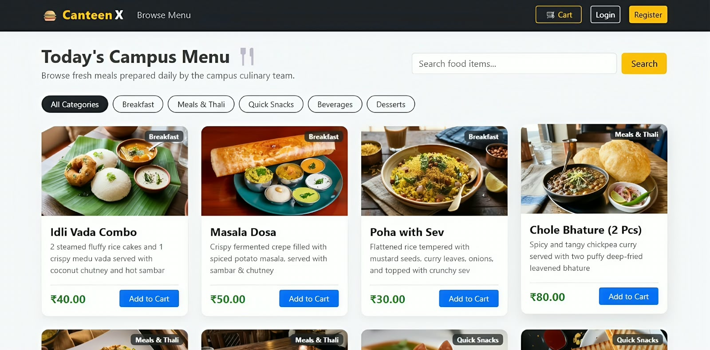
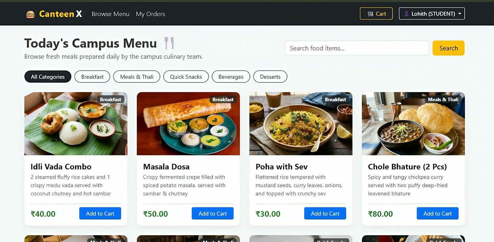
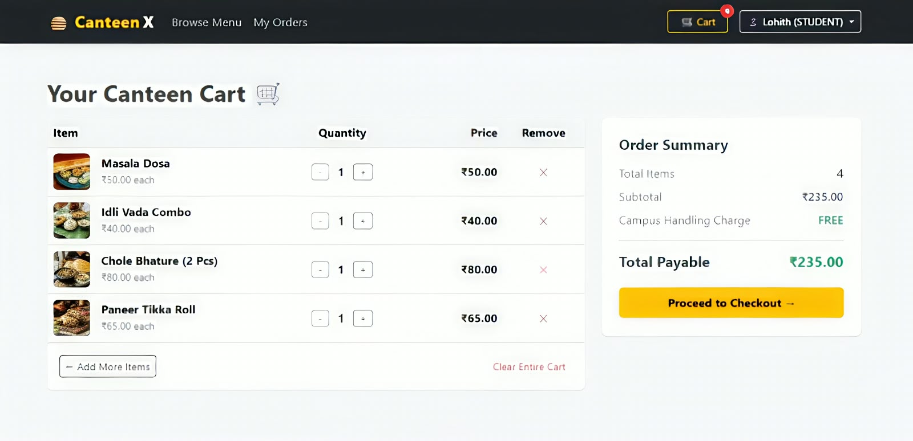
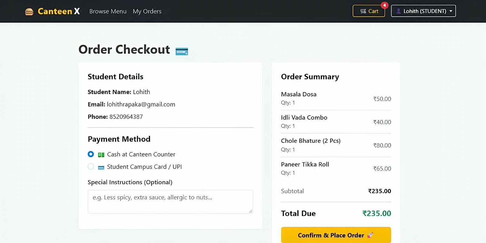
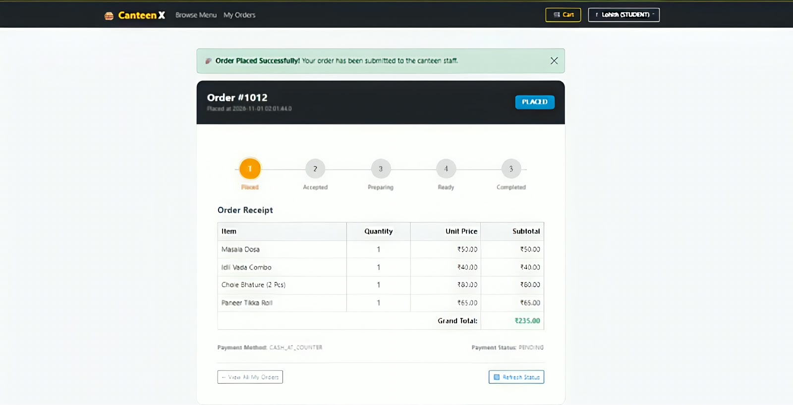
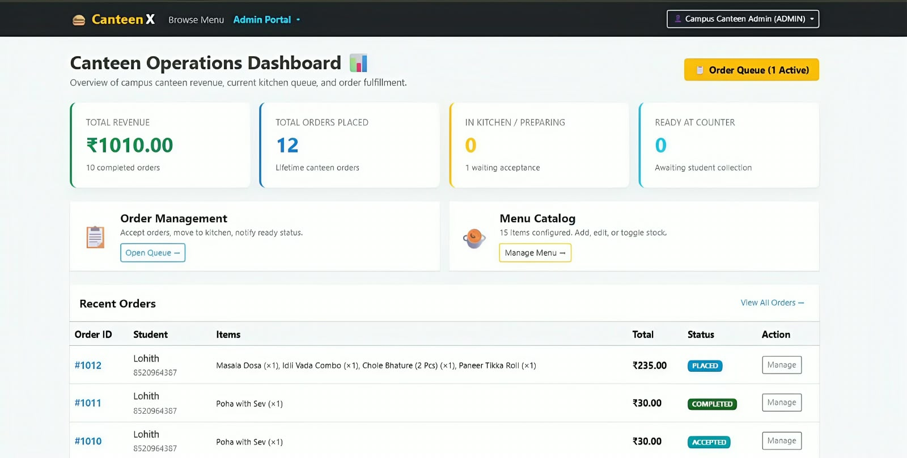
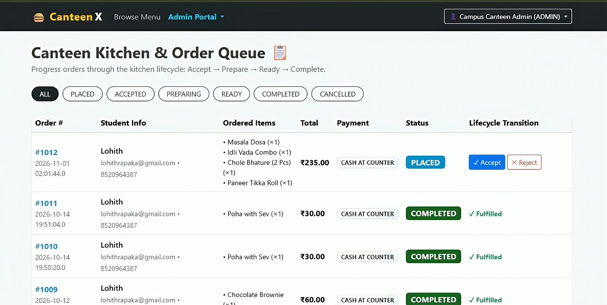

## Application Screenshots

Explore the CanteenX application through the following screenshots, demonstrating the complete student ordering workflow and administrative operations.

### 1. Home Page – Food Menu
Students and visitors can browse available food items, explore categories, and search for their favourite meals.

### 2. Student Food Menu
Authenticated students can explore the food catalog and add their selected items to the shopping cart.

### 3. Shopping Cart
Students can review selected items, update quantities, remove products, and view the total order amount.

### 4. Checkout
Students can review their personal details, choose a payment method, add special instructions, and confirm their order.

### 5. Order Confirmation and Tracking
After placing an order, students receive an order confirmation with order details, payment information, and order progress.

### 6. Admin Dashboard
Administrators can monitor total revenue, order statistics, kitchen activity, and recent orders from a centralized dashboard.

### 7. Admin Order Management
Administrators can view incoming orders, filter them by status, and manage the order lifecycle from placement to completion.

